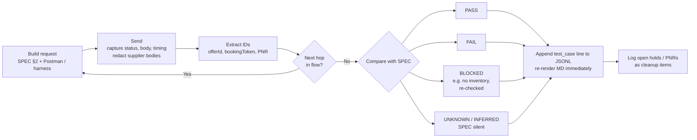
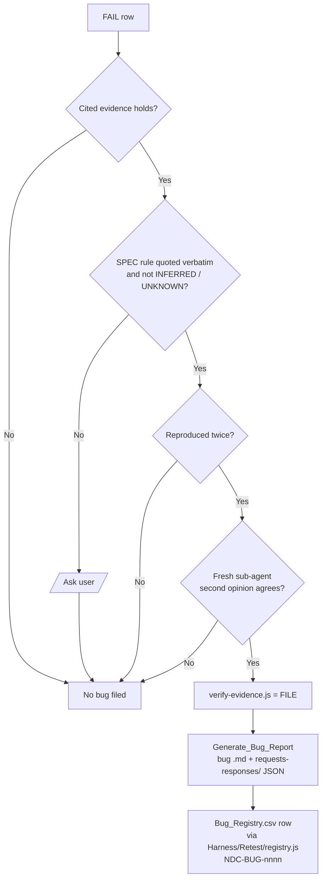

# Execution Pipeline: what happens after "run ..."

This page describes the path a request like *"run TestCases_Void.csv for SabreNdc on ne-3"* takes,
from the moment it is typed to the final report. It is a map. The rules themselves live in
`CLAUDE.md`, the skill files under `.claude/Skills/`, and `.claude/Skills/_shared/`.

Last verified: 2026-11-22 / n/a (process doc) / n/a

---

## 1. Overview

```mermaid
flowchart TD
    A([User: "run ..."]) --> B{Is the request complete?<br/>supplier, host, selector,<br/>version, scope}
    B -- No --> C[Optimize_Prompt<br/>rewrite + ask questions<br/>never executes]
    C --> U[/User answers or confirms/]
    U --> B
    B -- Yes --> D{Which task?}
    D -- "test-case CSV / flow / smoke" --> E[Execute_Test_cases]
    D -- "retest bugs / ADO ids / bug sheet" --> R[Retest_Issues<br/>runner.js + recipes]
    D -- "do fixtures still find flights" --> V[Validate_TestData_Search<br/>Search only]

    E --> F[Read sources<br/>SPEC.md + KB supplier file<br/>+ Environments.md + .env]
    F --> G{Safety checks}
    G -- "Book/Void/... on non-staging<br/>without permission" --> H[/Ask user for permission/]
    H --> G
    G -- OK --> I[Open run log<br/>Generate_QA_Report<br/>slug.jsonl + live slug.md + build]
    I --> J[[Loop: one TC-ID at a time]]
    J --> K[Close run<br/>run_end + HTML render<br/>validate-output.js]
    K --> L{Any FAIL rows?}
    L -- Yes --> M{verify-evidence.js<br/>gate = FILE?}
    M -- Yes --> N[Generate_Bug_Report<br/>one folder per bug<br/>+ Bug_Registry.csv via registry.js]
    M -- No --> O[Keep as finding / risk<br/>no bug filed]
    L -- No --> P
    N --> P[Summary to user<br/>verdict + counts first<br/>defects, blocked, cleanup]
    O --> P
    P --> Q[Update_Spec_From_Findings<br/>SPEC diffs + KB proposals<br/>only with user approval]
```

---

## 2. Step by step

### Step 0. Check the request (`Optimize_Prompt`)

These slots are required. If any is missing, the user is asked; nothing is guessed (CLAUDE.md rule 5).

| Slot | Example |
|---|---|
| Supplier | `SabreNdc` |
| Environment / host | `ne-3` (see `KB/03_Technical/Environments.md`) |
| credentialsSelector | `EGY` |
| Version | `V1`, `V2`, or `V1 and V2` (both must pass, rule 6) |
| Scope | a CSV, flow numbers, TC-IDs, or a category |

`Optimize_Prompt` shows the before/after prompt and waits for confirmation. It never calls the API.

### Step 1. Pick the skill

| The user says | Skill |
|---|---|
| "run TestCases_X.csv / flow N / smoke" | `Execute_Test_cases` |
| "retest ADO 65507 / bug sheet / RC regression" | `Retest_Issues` |
| "check the test data still finds flights" | `Validate_TestData_Search` |

### Step 2. Read the sources

| Source | Why |
|---|---|
| `NDC_Integration/SPEC.md` | The oracle: §2 endpoints, §5 flows, §6 validation rules |
| `KB/02_Suppliers/<Supplier>.md` | Live capabilities, routes, known bugs, gotchas |
| `KB/03_Technical/Environments.md` | Host base URLs |
| Repo-root `.env` (`NDC_API_KEY`) | API key. Never printed, never committed (rule 3) |

A KB fact older than 14 days, or from a different host, is re-checked live first.

### Step 3. Safety checks

- **Book / BookAfterHold / Void / CancelAfterHold** on a non-staging host need explicit permission
  in the conversation (rule 2). `ndc-supplier-integration` is not staging.
- **Supplier-only scope**: rows that need another supplier are `BLOCKED (out of scope)` (rule 4).
- **Sequential calls** unless the supplier file says parallel is safe (rule 9).

### Step 4. Open the run log (`Generate_QA_Report`)

- Run slug: `YYYYMMDD-HHMMSS_<Supplier>-<Selector>-<Scope>[-RoundN]-<env>`
- Files: `NDC_Integration/Artifacts/Logs/<slug>.jsonl` (data) and `<slug>.md` (live render).
- The `build` is logged at run start.

### Step 5. Run each test case



Rules inside the loop:

- The counted unit is **one TC-ID**. Hops inside a flow are detail, not counted (rule 7).
- One empty `offers: []` is not proof of no inventory; re-check before `BLOCKED` (rule 10).
- A "Both" row passes only if V1 and V2 both pass (rule 6).
- A result that confirms a SPEC `UNKNOWN` becomes a `spec_update_proposed` line (`pending`).

### Step 6. Close the run

- Append `run_end` (`complete` or `interrupted`).
- Render the final HTML (and XLSX/DOCX if requested) from the JSONL. Counts come from scripts.
- `node .claude/Skills/_shared/scripts/validate-output.js <file>` must pass on each output.

### Step 7. Defect gate



Details: `.claude/Skills/_shared/AI_Guardrails.md` (rule 11).

### Step 8. Report to the user

Order of the summary:

1. Verdict and counts (PASS / FAIL / BLOCKED)
2. Defects: per-run `BUG-NN` with the run slug, plus `NDC-BUG-nnnn`
3. Blocked rows and why
4. **Cleanup**: every live hold / PNR left behind (rule 8)

### Step 9. SPEC and KB follow-up (`Update_Spec_From_Findings`)

- Each `pending` SPEC proposal is shown as an old → new diff; the user confirms or declines each.
- Applied / declined status is appended to the JSONL; the `.md` is re-rendered.
- Last, KB updates are proposed. No SPEC or KB edit happens without approval.

---

## 3. Retest variant (`Retest_Issues`)

```mermaid
flowchart LR
    A[IDs / bug sheet] --> B[Resolve via<br/>Bug_Registry.csv]
    B --> C[Load recipe<br/>Harness/recipes/GlobalId.json<br/>draft + approve if missing]
    C --> D[Pre-flight test data<br/>no flights = Blocked]
    D --> E[/Booking permission<br/>if Hold/Book steps/]
    E --> F[runner.js<br/>code-decided verdict]
    F --> G[Fixed / Still reproduces /<br/>Blocked / Behaviour changed]
    G --> H[Regression ring<br/>neighbour flows]
    H --> I[RC_Retest_Report.md<br/>+ registry rows updated]
```



---

## 4. Writing a complete command

A command that fills every slot skips the questions in Step 0:

```
run TestCases_Void.csv for SabreNdc, selector EGY, host ne-3, V1 and V2, booking allowed
```

| Part | Fills slot |
|---|---|
| `TestCases_Void.csv` | Scope |
| `SabreNdc` | Supplier |
| `EGY` | credentialsSelector |
| `ne-3` | Host |
| `V1 and V2` | Version |
| `booking allowed` | Permission for Book / Void on a non-staging host |
