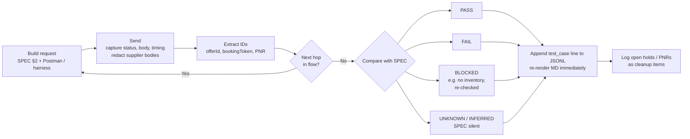
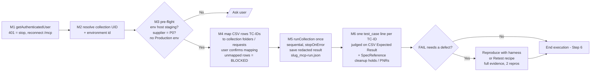
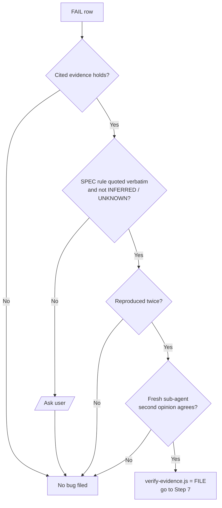
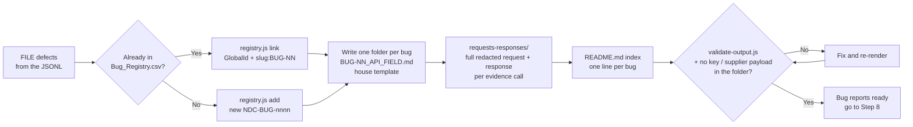
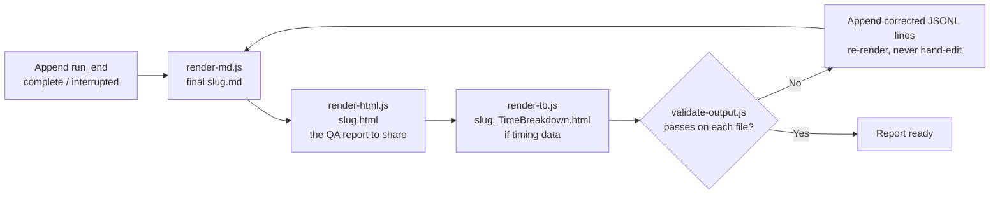

# Execution Pipeline: what happens after "run ..."

This page describes the path a request like *"run TestCases/Void/SabreNdc_Void_TestCases.csv for SabreNdc on ne-3"* takes,
from the moment it is typed to the final report. It is a map. The rules themselves live in
`CLAUDE.md`, the skill files under `.claude/Skills/`, and `.claude/Skills/_shared/`.

Last verified: 2026-11-22 / n/a (process doc, Postman MCP mode added) / n/a

---

## 1. Overview

```mermaid
flowchart TD
    A([User: "run ..."]) --> B{Is the request complete?<br/>supplier, host, selector,<br/>version, scope}
    B -- No --> C[Optimize_Prompt<br/>rewrite + ask questions<br/>never executes]
    C --> U[/User answers or confirms/]
    U --> B
    B -- Yes --> D{Which task?}
    D -- "test-case CSV / flow / smoke" --> E[Execute_Test_cases]
    D -- "retest bugs / ADO ids / bug sheet" --> R[Retest_Issues<br/>runner.js + recipes]
    D -- "do fixtures still find flights" --> V[Validate_TestData_Search<br/>unavailable since 2026-11-22<br/>no TestData fixtures]

    E --> F[Read sources<br/>SPEC.md + KB supplier file<br/>+ Environments.md + .env]
    F --> G{Safety checks}
    G -- "Book/Void/... on non-staging<br/>without permission" --> H[/Ask user for permission/]
    H --> G
    G -- OK --> I[Open run log<br/>Generate_QA_Report<br/>slug.jsonl + live slug.md + build]
    I --> MODE{Run mode?}
    MODE -- "harness<br/>CSV / TC-IDs / flows" --> J[[Loop: one TC-ID at a time]]
    MODE -- "postman-mcp<br/>CSV run through a collection" --> JM[[Map CSV rows to collection<br/>runCollection once<br/>one test_case per TC-ID]]
    J --> K[End test execution<br/>phase end + final .md]
    JM --> K
    K --> L{Any FAIL rows?}
    L -- Yes --> M{verify-evidence.js<br/>gate = FILE?}
    M -- Yes --> N[Generate_Bug_Report<br/>one folder per bug<br/>+ Bug_Registry.csv via registry.js]
    M -- No --> O[Keep as finding / risk<br/>no bug filed]
    L -- No --> HT
    N --> HT
    O --> HT
    HT[QA Report HTML<br/>run_end + render-html.js<br/>slug.html + slug_TimeBreakdown.html<br/>validate-output.js] --> P[Summary to user<br/>verdict + counts first<br/>defects, blocked, cleanup<br/>+ link to the HTML report]
    P --> Q[Update_Spec_From_Findings<br/>SPEC diffs + KB proposals<br/>only with user approval]
```

---

## 2. Step by step

### Step 0. Check the request (`Optimize_Prompt`)

These slots are required. If any is missing, the user is asked; nothing is guessed (CLAUDE.md rule 5).

| Slot | Example |
|---|---|
| Supplier | `SabreNdc` |
| Environment / host | `ne-3` (see `KB/03_Technical/Environments.md`) |
| credentialsSelector | `EGY` |
| Version | `V1`, `V2`, or `V1 and V2` (both must pass, rule 6) |
| Scope | a CSV, flow numbers, TC-IDs, or a category; or a Postman collection + environment |
| Run mode | `harness` (CSV, TC-IDs, flows) or `postman-mcp` (a named Postman collection); asked if unclear |

`Optimize_Prompt` shows the before/after prompt and waits for confirmation. It never calls the API.

### Step 1. Pick the skill

| The user says | Skill |
|---|---|
| "run TestCases_X.csv / flow N / smoke" | `Execute_Test_cases` |
| "retest ADO 65507 / bug sheet / RC regression" | `Retest_Issues` |
| "check the test data still finds flights" | `Validate_TestData_Search` (unavailable since 2026-11-22: no `TestData/` fixtures) |

### Step 2. Read the sources

| Source | Why |
|---|---|
| `NDC_Integration/SPEC.md` | The oracle: §2 endpoints, §5 flows, §6 validation rules |
| `KB/02_Suppliers/<Supplier>.md` | Live capabilities, routes, known bugs, gotchas |
| `KB/03_Technical/Environments.md` | Host base URLs |
| Repo-root `.env` (`NDC_API_KEY`) | API key. Never printed, never committed (rule 3) |

A KB fact older than 14 days, or from a different host, is re-checked live first.

### Step 3. Safety checks

- **Book / BookAfterHold / Void / CancelAfterHold** on a non-staging host need explicit permission
  in the conversation (rule 2). `ndc-supplier-integration` is not staging.
- **Supplier-only scope**: rows that need another supplier are `BLOCKED (out of scope)` (rule 4).
- **Sequential calls** unless the supplier file says parallel is safe (rule 9).

### Step 4. Open the run log (`Generate_QA_Report`)

- Run slug: `YYYYMMDD-HHMMSS_<Supplier>-<Selector>-<Scope>[-RoundN]-<env>`
- Files: `NDC_Integration/Artifacts/Logs/<slug>.jsonl` (data) and `<slug>.md` (live render).
- The `build` is logged at run start.

### Step 5. Run each test case



Rules inside the loop:

- The counted unit is **one TC-ID**. Hops inside a flow are detail, not counted (rule 7).
- One empty `offers: []` is not proof of no inventory; re-check before `BLOCKED` (rule 10).
- A "Both" row passes only if V1 and V2 both pass (rule 6).
- A result that confirms a SPEC `UNKNOWN` becomes a `spec_update_proposed` line (`pending`).

### Step 5 (Postman MCP mode). Run the test cases through a collection

Used when a test-case CSV is run through a named Postman collection: the test cases are part of the
collection run. Setup and IDs: `KB/03_Technical/Postman_MCP_Guide.md`. Steps M1-M6 in
`.claude/Skills/Execute_Test_cases/SKILL.md`.



- The counted unit stays the CSV's TC-ID. Collection folders with no CSV row run but are only
  logged as observations.
- The CSV row's Expected Result + SpecReference is the oracle. A FAIL that only a Postman test
  script reports is `INFERRED` (a question, not a defect).
- `runCollection` always runs the **whole** collection (no folder filter).

### Step 6. End test execution and defect gate

- `"Test Execution"` phase end; the `.md` is re-rendered from the JSONL.
- `run_end` is **not** written yet, so the HTML report (Step 8) includes the filed defects.
- Defect gate: `node .claude/Skills/_shared/scripts/verify-evidence.js NDC_Integration/Artifacts/Logs/<slug>.jsonl`



Details: `.claude/Skills/_shared/AI_Guardrails.md` (rule 11). QUESTION and NEEDS-HUMAN items go to
the user; only FILE defects continue.

### Step 7. Bug reports (`Generate_Bug_Report`)

Skill: `.claude/Skills/Generate_Bug_Report/SKILL.md`. Runs once per run, for FILE defects only,
with the same `<slug>`, inside its own `"Bug Reporting"` phase. No FILE defect: skip to Step 8.



| Output | Where |
|---|---|
| One bug report per defect | `NDC_Integration/Artifacts/BugReports/<slug>/BUG-NN_<API>_<FIELD>/BUG-NN_<API>_<FIELD>.md` |
| Evidence files | `.../BUG-NN_<API>_<FIELD>/requests-responses/*_request.json`, `*_response.json` |
| Index | `NDC_Integration/Artifacts/BugReports/<slug>/README.md` |
| Registry row (permanent ID) | `NDC_Integration/Artifacts/Registry/Bug_Registry.csv`, only through `Harness/Retest/registry.js` |
| DOCX copy | only on request (`render-docx.js`) |

Each report has: title `[V2][<Supplier>][<API>] – …`, Description, Steps to Reproduce, Actual /
Expected Result (JSON snippets), System Information (host, selector, Correlation ID), Severity,
Evidence, Registry ID. The API key and `supplierRequest`/`supplierResponse` bodies are redacted.

### Step 8. QA Report (HTML) (`Generate_QA_Report`)



| Output | Where |
|---|---|
| QA report (HTML) | `NDC_Integration/Artifacts/Logs/<slug>.html` |
| Time Breakdown (HTML) | `NDC_Integration/Artifacts/Logs/<slug>_TimeBreakdown.html` |
| Final Markdown / data | `NDC_Integration/Artifacts/Logs/<slug>.md`, `<slug>.jsonl` |
| XLSX / DOCX | only on request |

The HTML is rendered once per run, from the JSONL only. An interrupted run still gets its HTML.
Scripts: `.claude/Skills/Generate_QA_Report/scripts/render-{md,html,tb}.js <slug>`.

### Step 9. Report to the user

Order of the summary:

1. Verdict and counts (PASS / FAIL / BLOCKED)
2. Defects: per-run `BUG-NN` with the run slug, plus `NDC-BUG-nnnn`
3. Blocked rows and why
4. **Cleanup**: every live hold / PNR left behind (rule 8)
5. Links: `<slug>.html`, `<slug>_TimeBreakdown.html`, `BugReports/<slug>/`

### Step 10. SPEC and KB follow-up (`Update_Spec_From_Findings`)

- Each `pending` SPEC proposal is shown as an old → new diff; the user confirms or declines each.
- Applied / declined status is appended to the JSONL; the `.md` is re-rendered.
- Last, KB updates are proposed. No SPEC or KB edit happens without approval.

---

## 3. Retest variant (`Retest_Issues`)

```mermaid
flowchart LR
    A[IDs / bug sheet] --> B[Resolve via<br/>Bug_Registry.csv]
    B --> C[Load recipe<br/>Harness/recipes/GlobalId.json<br/>draft + approve if missing]
    C --> D[Pre-flight test data<br/>no flights = Blocked]
    D --> E[/Booking permission<br/>if Hold/Book steps/]
    E --> F[runner.js<br/>code-decided verdict]
    F --> G[Fixed / Still reproduces /<br/>Blocked / Behaviour changed]
    G --> H[Regression ring<br/>neighbour flows]
    H --> I[RC_Retest_Report.md<br/>+ registry rows updated]
```



---

## 4. Writing a complete command

A command that fills every slot skips the questions in Step 0:

```
run TestCases/Void/SabreNdc_Void_TestCases.csv for SabreNdc, selector EGY, host ne-3, V1 and V2, run mode harness, booking allowed
```

Postman MCP mode:

```
run TestCases_V2.csv through Postman collection NDC_Integrations_Staging_V2
with environment STAG_ENV via MCP, for SabreNdc, selector EGY, host ne-3, V2
```

| Part | Fills slot |
|---|---|
| `TestCases/Void/SabreNdc_Void_TestCases.csv` | Scope |
| `SabreNdc` | Supplier |
| `EGY` | credentialsSelector |
| `ne-3` | Host |
| `V1 and V2` | Version |
| `booking allowed` | Permission for Book / Void on a non-staging host |
